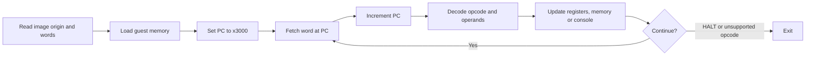

# LC-3 Virtual Machine

A C implementation of the educational LC-3 processor, with assembly exercises and saved program images from my university coursework. The emulator loads 16-bit machine words, executes instructions and provides character and string I/O through console TRAP handlers.

The project brings together three preserved C source versions, eight small assembly exercises and a separately attributed 2048 example. The primary implementation is based on [Write your Own Virtual Machine](https://www.jmeiners.com/lc3-vm/) by Justin Meiners and Ryan Pendleton.

## At a glance

| Component | Implementation |
| --- | --- |
| Host language | C99 |
| Guest architecture | LC-3, 16-bit words and addresses |
| Memory | 65,536 words, equivalent to 128 KiB |
| Registers | R0 through R7, program counter and N/Z/P condition flags |
| Entry point | `x3000` |
| Instructions | Arithmetic, logic, branches, calls, loads, stores and host TRAP handlers |
| Console services | `GETC`, `OUT`, `PUTS`, `IN`, `PUTSP`, `HALT` |
| Guest programs | Nine `.asm` sources and nine saved `.obj` images |

## Build and run

Use a C99 compiler such as Clang or GCC and an interactive terminal on macOS or Linux. `make` is optional. The emulator has no external library dependency.

```sh
git clone https://github.com/lukamaga/lc3-virtual-machine.git
cd lc3-virtual-machine
make
./build/lc3 examples/basics/input.obj
```

Enter one character when prompted. This example reads and echoes a character, prints a response and reaches `HALT`. Some prompts are in Russian, as in the saved implementation.

To build without Make:

```sh
mkdir -p build
cc -std=c99 -O2 src/lc3.c -o build/lc3
./build/lc3 examples/basics/ld.obj
```

`HALT` ends execution; `Ctrl+C` interrupts it. The POSIX code restores terminal settings on its normal exit paths after a successful terminal-mode change.

The source also retains a Windows branch. Windows console behavior has not been validated, and that branch does not apply the same input-mode changes as POSIX. The commands above target macOS and Linux.

### Loading images

```text
./build/lc3 image.obj [additional-image.obj ...]
```

The first word in each image specifies its load address. Images are loaded in argument order, so later images overwrite earlier words wherever their address ranges overlap. Execution always begins at `x3000`, regardless of the image headers. All nine included images have that origin.

These `.obj` files are LC-3 guest programs, not native build artifacts. They are deliberately included. An assembler is needed only when changing the assembly sources; see the [example guide](docs/examples.md#assembly-source-and-object-images).

## How execution works



The four most significant bits select the opcode. The remaining bits encode register indices, immediate values or signed offsets. PC-relative addressing uses the already incremented program counter. Arithmetic results and addresses are stored as 16-bit values.

See [Architecture and image format](docs/architecture.md) for the instruction groups, addressing rules and console interface.

## Assembly exercises

| Files | Subject |
| --- | --- |
| [`input.asm`](examples/basics/input.asm) | Character input, output and console TRAP calls |
| [`ld.asm`](examples/basics/ld.asm) | PC-relative, indirect and base-register addressing |
| [`add.asm`](examples/basics/add.asm), [`sub.asm`](examples/basics/sub.asm) | Small integer arithmetic and ASCII conversion |
| [`loop.asm`](examples/basics/loop.asm) | A decrementing counter and conditional branches |
| [`mul.asm`](examples/basics/mul.asm) | A saved decrementing-loop experiment; it does not implement multiplication |
| [`simb.asm`](examples/basics/simb.asm) | Reading and displaying a character buffer |
| [`sum_large.asm`](examples/basics/sum_large.asm) | An unfinished decimal-output and subroutine experiment |
| [`2048.asm`](examples/2048/2048.asm) | Ryan Pendleton's game, retained with its license and local keyboard-address adaptation |

The original exercise sources and images are preserved unchanged. Several experiments contain incomplete output or subroutine logic; the [example guide](docs/examples.md) describes their actual behavior and limitations. The saved source/image pairs have not been reassembled to verify that every pair represents exactly the same revision.

**2048 compatibility:** the saved game polls keyboard addresses `x1E00` and `x1E02`. The primary emulator does not implement these memory-mapped devices. The game is included as an archived guest program, not as a supported demo for the default executable. Read its [compatibility notes](examples/2048/README.md) before using it.

## Repository layout

```text
src/lc3.c                 Primary emulator
examples/basics/           Eight assembly exercises and saved images
examples/2048/             Third-party game, image and compatibility notes
archive/clion_draft/       Earlier standalone C draft
archive/course_vm/         Separate saved coursework VM source
docs/                     Architecture, examples and preservation notes
licenses/                 Original third-party code notices
Makefile                  Builds build/lc3
```

The original eight-commit Git history of the separate coursework VM is available on [`archive/course-vm`](https://github.com/lukamaga/lc3-virtual-machine/tree/archive/course-vm). Its historical authors and dates are retained. The same final C source is also included in the default branch under `archive/course_vm` for easy access.

## Implementation scope

This is an instruction interpreter with direct host console services. It does not implement interrupts, privilege modes, a guest operating system, device timing or keyboard MMIO. `RTI` and the reserved opcode stop execution; unsupported TRAP vectors have no handler. It is not designed to isolate untrusted programs.

The primary source includes focused corrections to binary-image loading, `PUTS`, string bounds, terminal restoration and `JSRR R7`. The original source remains available in the initial import commit. [Preservation notes](docs/preservation.md) identify each version and explain these changes.

The publication was reviewed through source inspection, file hashes and documentation checks. The emulator and examples were not compiled, assembled or executed during that review.

## References and attribution

- [Write your Own Virtual Machine](https://www.jmeiners.com/lc3-vm/): the tutorial used by the preserved emulator sources.
- [LC-3 ISA, Appendix A](https://www.jmeiners.com/lc3-vm/supplies/lc3-isa.pdf): instruction encoding and architecture reference.
- [lc3tools](https://github.com/haplesshero13/lc3tools): an external assembler and simulator toolchain.
- [lc3-2048](https://github.com/rpendleton/lc3-2048): the original game by Ryan Pendleton.

Coursework collection maintained by [lukamaga](https://github.com/lukamaga). Tutorial-derived code and the 2048 example retain their respective [MIT notices](licenses/README.md). The tutorial article, figures and the external assembler distribution are not bundled.
